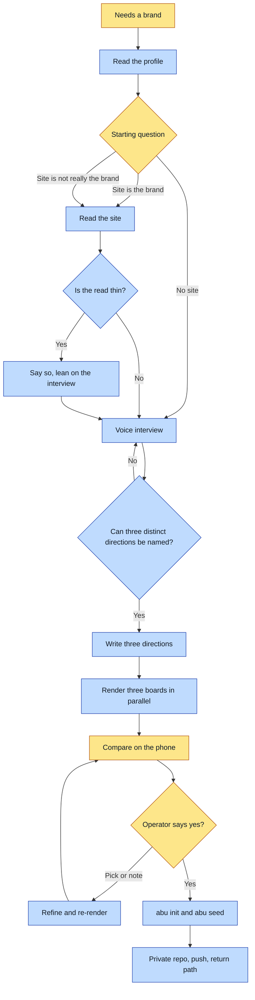

# Purpose

A person who publishes pages ends up with a private brand universe they approved by looking at
it, so every later page reads its colors, type and mark from one record instead of being styled
by guess. The human decides the look; the agent does the reading, drafting, rendering and filing.

# When to use (Trigger)

Someone needs a brand for their own pages (an artifact hub, a personal site) and has none, or
wants to redo the one they have. Not a company rebrand, and not one image.

# Inputs / Prerequisites

- The operator's profile in their workspace, read first.
- A site URL, if they have one (read with `read-site.mjs`).
- A phone for the voice interview and the side-by-side compare.
- Node 22+, Chrome, uv (`brew install uv`; it runs the outline helper with pinned fonttools and brotli), network for Google Fonts.
- A GitHub owner for the private repo.

# Roles

| Role | Responsibility |
|---|---|
| **Operator** | Answers the starting question, answers the interview, picks and notes, and says yes. Owns the taste. |
| **Agent executor** | Reads the profile and site, runs the interview, drafts three directions, renders boards, refines, seeds and pushes. Never decides. |

# Procedure

1. Read the profile; never ask what it already says.
2. Ask the starting question: three answers, worded with the operator's name, default "does not have one".
3. If there is a site, read it. If it is thin, say so.
4. Interview by voice through `freedom:interview-me` until three distinct directions can be named.
5. Write three `direction.json` files that differ in concept; a kept site is one of them.
6. Render all three boards in parallel; check each, including its footer.
7. Compare the three PNGs on their phone.
8. Refine with their notes and mixes until they say yes. Nothing is golden before it.
9. On yes: write the brief, `abu init`, `abu seed` from the `.fixed.json` with the board as anchor and the `.mark.svg`, `gh repo create ... --private` and push, return the path.

# Process Flowchart

Amber = irreducibly human. Blue = agent-executed.

# Done / Verification

The universe validates (`abu init` prints OK; `abu seed` runs against it), `freedom-brand.mjs
emit --universe <path> --surface artifact` prints the approved ground, text, accent and display, the
board is the register anchor, the brief exists, the private repo is pushed, and the operator
said yes in their own words before any of it was written.

# Exceptions & Troubleshooting

- **A site font that is not on Google Fonts** is swapped for the closest Google family and the
  original is recorded in `sources`; the board footer names the stand-in.
- **A weak ink or accent** is lifted to 4.5:1 and the board says so; the seeded direction is the
  fixed one, never the original.
- **A mid-tone ground can make a contrast target unreachable;** the note says so instead of claiming success.
- **A transparent page** records `unresolved` for ground or text; do not default to white.
- **Offline,** the mark outlines and board fonts cannot be fetched; say so and stop.

# Automation Opportunities

**Already automated:** reading a site's colors, fonts and logo, contrast repair, the board, the
mark outlines, the seed with recipes.

**Irreducibly human:** the starting answer, the interview answers, the pick, the notes, the yes.

**Strongest next candidate:** tracing a raster logo to SVG as part of the read.

# Related

- [explore](../explore/SKILL.md): the comparison-set verb for single taste questions.
- [on-brand-image](../on-brand-image/SKILL.md): images in the approved register.

# Revision History

| Version | Date | Changes |
|---|---|---|
| 0.1 | 2026-10-20 | Written with the skill. |
